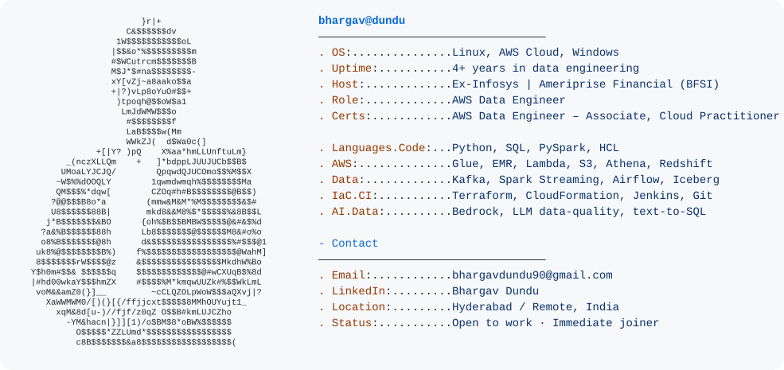

<picture>
  <source media="(prefers-color-scheme: dark)" srcset="dark_mode.svg">
  
</picture>

## 🛠️ Tech Stack

  

  
  
  
  
  
  
  
  
  

## 🚀 Featured Projects

| Project | What it does | Stack |
|---|---|---|
| [kafka-spark-realtime-streaming](https://github.com/bhargavdundu90-dev/kafka-spark-realtime-streaming) | Streams card/UPI payments through Kafka and Spark, flags fraud patterns with watermarked sliding windows | Kafka, Spark Structured Streaming, S3, Terraform |
| [cdc-debezium-kafka-pipeline](https://github.com/bhargavdundu90-dev/cdc-debezium-kafka-pipeline) | Captures Postgres core-banking changes with Debezium and builds an auditable SCD Type 2 customer dimension with DQ-gated daily promotes | Debezium, Kafka, PySpark, Glue, Athena, Terraform |
| [aws-data-engineering-labs](https://github.com/bhargavdundu90-dev/aws-data-engineering-labs) | Hands-on AWS data engineering labs, a new one most days | Glue, Athena, Lambda, Redshift, PySpark |

## 📊 GitHub Stats

  
  

  

## 📈 Contribution Activity

## 🏅 Certifications

  
  

